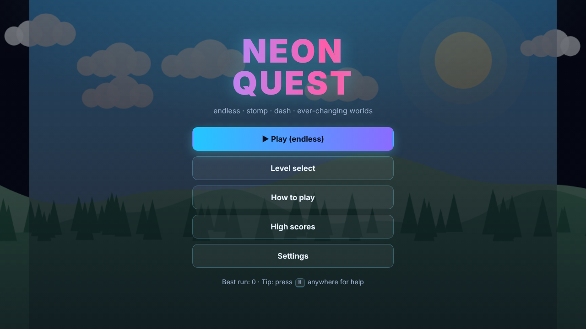
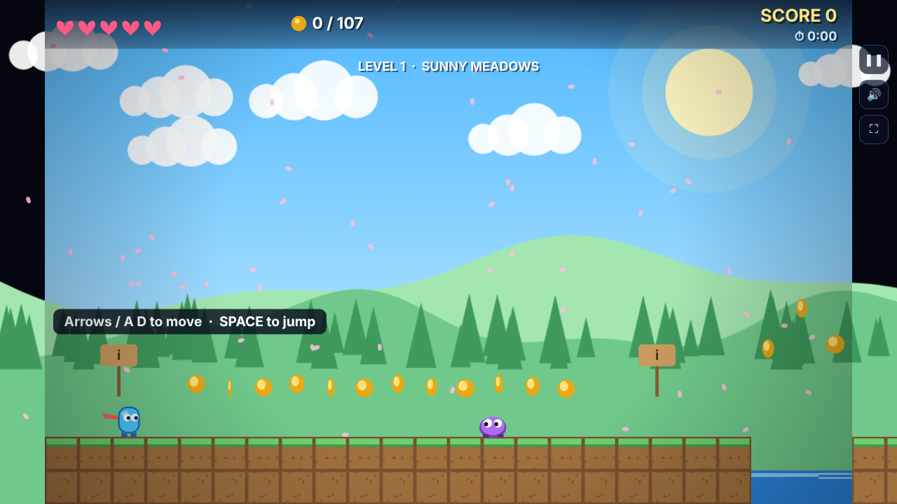
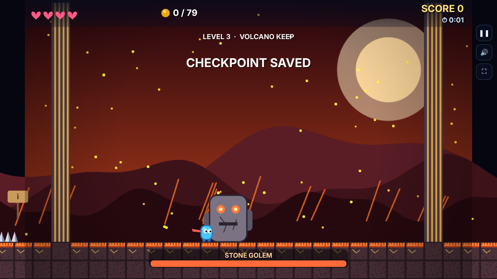
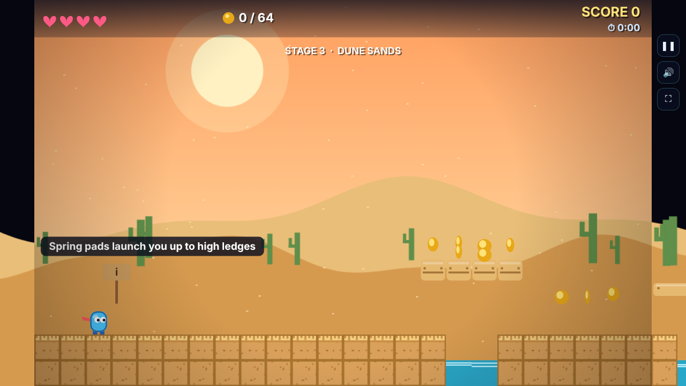
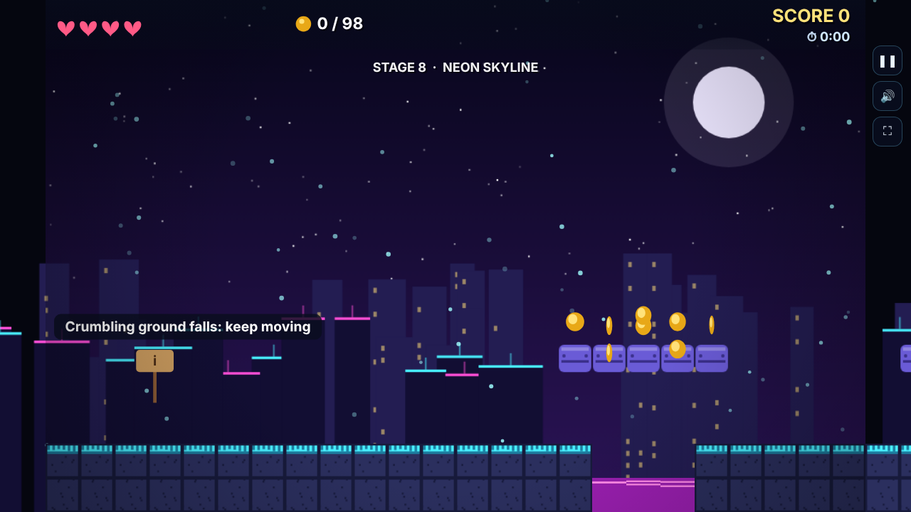
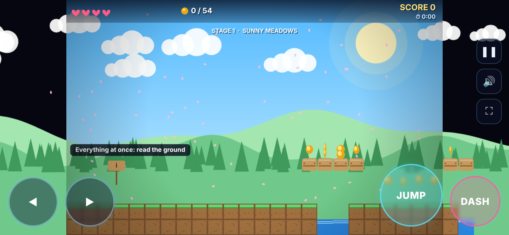

# NEON QUEST

An endless neon platformer with a 3-level campaign and a boss fight. It runs in any modern browser on
**PC, laptop, phone and tablet**, works offline once loaded, and can be installed
to your home screen like an app.

- **Endless mode (▶ Play)**: stage after stage, forever. Every run shuffles six worlds
  (Sunny Meadows, Frozen Caverns, Volcano Keep, Dune Sands, Neon Skyline, Cloud Isles) and eight
  obstacle mixes. When the lives run out, the score resets and a new run starts.
- **Campaign: 3 hand-built levels**: Sunny Meadows, Frozen Caverns, Volcano Keep
- **Boss fight**: the Stone Golem, with arena walls that lock you in
- **Moves**: run, variable-height jump, coyote time, jump buffer, **dash** (invincible, smashes enemies)
- **Hazards and mechanics**: walkers, flying bats, turrets, rocks, spikes, lava and water pits,
  spring pads, moving platforms, crumbling platforms, checkpoints, combos
- **Scoring**: coins, stomp combos, dash smashes, boss, time bonus, no-damage and all-coins bonuses
- **Main menu, level select, how to play, high scores, settings**
- **Procedural music and sound effects** (Web Audio, no audio files)
- **Graphics drawn in code**: parallax skies, animated characters, particles, weather, HUD
- **Controls**: keyboard, gamepad and on-screen touch buttons
- **Saves locally**: best scores, level unlocks and settings (stored in your browser)

---

## Screenshots



| Campaign | Stone Golem | Endless worlds |
|---|---|---|
|  |  |  |





---

## Technology and architecture

NEON QUEST is a static HTML5 application using CSS, vanilla JavaScript, Canvas 2D,
the Web Audio API, LocalStorage, the Gamepad API, and a service worker. It has no
framework, build step, package manager, or runtime dependency. Graphics are drawn
in code; music and sound effects are generated procedurally.

`index.html` loads the JavaScript modules directly. `levels.js` and `generator.js`
define campaign and endless content; `world.js` and `entities.js` implement the
world and physics; `render.js` draws the game; `game.js` owns input, state, scoring,
and saves; `ui.js` provides menus and PWA integration; and `audio.js` generates sound.

## Prerequisites

- A modern browser with JavaScript enabled.
- Python 3 for the recommended local web server.
- Node.js only to run `tests/terrain_bot.js`.
- For the optional browser smoke test: the Playwright Python package and its Chromium browser.

No npm install, build, or application dependency installation is needed to play.

## Install and run locally

### Recommended: run a local server
Open the project root in VS Code, open the integrated terminal, and run:
```sh
python -m http.server 8000
```
Open <http://localhost:8000> in your browser. Stop the server with `Ctrl+C` in
that terminal.

Alternatively, use the VS Code **Live Server** extension: install it if needed,
right-click the root `index.html`, and choose **Open with Live Server** (or click
**Go Live**). Serving over HTTP is preferable to opening the file directly because
service workers and some browser features require a supported origin. `localhost`
works for local development; public deployments should use HTTPS.

---

## Deploy it (free) so anyone can play

The game is plain static files, so any static host works.

### Option A: GitHub Pages
1. In this repository, open **Settings → Pages → Build and deployment**.
2. Choose **Deploy from a branch**, then select branch `main` and folder `/(root)`.
3. After deployment completes, open <https://yashsurve2006.github.io/NEON-QUEST/>.

The game entry point is at the repository root, so no build command is needed.
Subsequent pushes to `main` update the published site.

### Option B: Netlify Drop (no account needed to try)
Go to <https://app.netlify.com/drop> and drag the `neon-quest` folder onto the page.
You get a public HTTPS link immediately.

### Option C: itch.io (good for a game audience)
1. Zip the **contents** of the folder so `index.html` sits at the root of the zip.
2. Create a new project on itch.io, set *Kind of project* to **HTML**, upload the zip,
   tick **This file will be played in the browser**, and set the viewport to 960 × 600.

### Option D: Your own server or Vercel / Cloudflare Pages
Upload the folder as a static site. No build step is needed.

> HTTPS matters: the offline mode and "Install app" need an `https://` address
> (`localhost` works too for testing).

---

## Install as a PWA and use offline

On a supported browser, open the HTTPS deployment or local `localhost` address and
use the browser's **Install app** option or the game's **Install app** menu button
when available. On iPhone or iPad, use Safari's **Share → Add to Home Screen**.
Install prompts vary by browser and platform.

The service worker is registered on HTTP(S) and precaches the app shell on its
first successful load. To check offline behavior, load the game once while online,
wait for it to finish loading, then use the browser developer tools to set the
network to offline and reload. The cached shell should still open. Reconnect before
expecting uncached resources or external browser services to work.

Scores, level unlocks, settings, and player name are saved in browser LocalStorage
for the current site origin and remain on that browser/device. Clearing site data
removes them; saves do not sync between devices.

---

## How to play

| Action | Keyboard | Gamepad | Touch |
|---|---|---|---|
| Move | ← → or A D | D-pad / stick | ◀ ▶ |
| Jump (hold for higher) | Space, ↑, W, Z | A / south face button | JUMP |
| Dash | Shift, J, K, X | X or B / west or east face button | DASH |
| Pause | P or Esc | Start | ❚❚ |
| Restart stage (keeps lives) | R, or the pause menu | — | Pause menu |
| Mute / Fullscreen | M / F | — | Top-right buttons |
| Help (menu or pause) | H | — | How to play menu |

Gamepad labels vary by controller and browser. Directional input uses the D-pad or
left stick.

Stomp enemies from above to squash them. Chain stomps without touching the ground
for a combo (x2 up to x5). Dash through enemies and turrets to smash them. Collect
coins (+10); every 30 coins gives a bonus life. Reach the flag. In Volcano Keep you must
stomp the Stone Golem's head three times to open the gate.

**Lives:** you start with 4. Losing one respawns you at the last checkpoint. In an endless run,
losing the last life ends the run: the score is saved to the high scores and a new run starts at 0.
In the campaign, Retry gives you 4 lives and resets that level's score.

Full details are in the game's **How to play** screen.

---

## Project layout

```
neon-quest/
├── index.html          the page: menus, overlays, touch controls
├── style.css           neon theme and responsive layout
├── js/
│   ├── audio.js        procedural music sequencer and sound effects (Web Audio)
│   ├── levels.js       the three campaign level layouts (edit me to make new levels)
│   ├── generator.js    endless mode: builds unlimited stages from seeds (themes, obstacle mixes)
│   ├── world.js        tile grid, moving and crumbling platforms, boss arena walls
│   ├── entities.js     player physics, walkers, bats, turrets, Stone Golem, particles
│   ├── render.js       all graphics: parallax backgrounds, tiles, characters, HUD
│   ├── game.js         game loop, input, rules, scoring, state machine, saves
│   └── ui.js           menus, level select, scores, settings, touch, install prompt
├── icons/              app icons (SVG + PNG)
├── manifest.webmanifest   makes the game installable
├── sw.js               service worker: offline play after the first visit
├── tests/
│   ├── smoke.py        headless browser test (menus, gameplay, screenshots, JS errors)
│   └── terrain_bot.js  proves every level is reachable with the real physics
└── neon_quest_pygame.py  the original desktop (pygame) version, kept for reference
```

---

## Making changes

**Tune the feel** in `js/entities.js` (object `P`): gravity `G`, jump velocity `JV`,
run speed `RUN`, dash `DASH_V` / `DASH_T`, coyote time, and so on.

**Add or edit a level** in `js/levels.js`. Each level is a plain object. For example,
to add a floating platform at row 9 from column 40 to 44:

```js
plats: [[9, 40, 44], ...]
```

Then check it's still completable:

```bash
node tests/terrain_bot.js
```

**Change the music** in `js/audio.js` (the `TRACKS` table: tempo, scale, chord
progression, instrument, seed). Or change the sound effects in `SFX`.

**Change colors and themes** in `js/render.js` (the `PAL` table) and the backgrounds
in `buildBg`.

**Change the endless mode** in `js/generator.js`: `THEMES` (names and music of each world) and
`FLAVORS` (the obstacle mixes and how often each hazard appears). The terrain bot checks
the campaign and a deterministic sample of 48 generated stages; rerun it after changes.

**Add a new world:** add a palette to `PAL` and a branch to `buildBg` in `js/render.js`, a track
to `TRACKS` in `js/audio.js`, and an entry to `THEMES` in `js/generator.js`.

**Bump the version** in `sw.js` (`CACHE` name) when you deploy changes, so returning
players get the update straight away.

---

## Tests

Run these commands from the project root. The browser smoke test requires the game
to be served over HTTP in a separate terminal.

The terrain bot requires Node.js and has no npm dependencies:

```sh
node tests/terrain_bot.js
```

The browser smoke test requires the Playwright Python package and its Chromium
browser. Install them once with:

```sh
python -m pip install playwright
python -m playwright install chromium
```

With the local server running on port 8000, run:

```sh
python tests/smoke.py http://127.0.0.1:8000/index.html tests/shots
```

`smoke.py` exercises menus, campaign and boss flows, endless runs, touch controls,
and desktop/mobile layouts. It captures screenshots and exits unsuccessfully on
JavaScript errors; these reproducible output images are not committed.
`terrain_bot.js` exercises all three campaign levels and 48 deterministic generated
endless stages with the game physics. A pass verifies those tested layouts are
reachable, not every possible generated stage.

The game has not been verified on every physical phone, tablet, browser, or
gamepad. PWA installation prompts, touch behavior, audio policies, and offline
support can vary across platforms.

---

## License

The project currently has no explicit license file. No license has been selected;
do not assume that public availability grants permission to reuse or redistribute
the code or assets.
